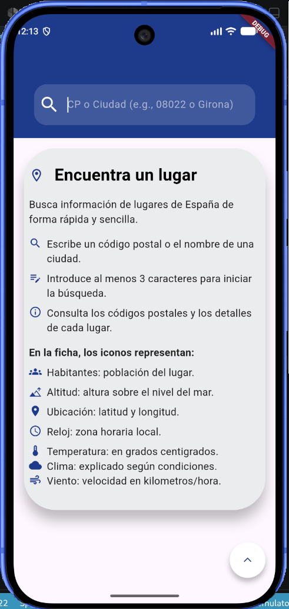
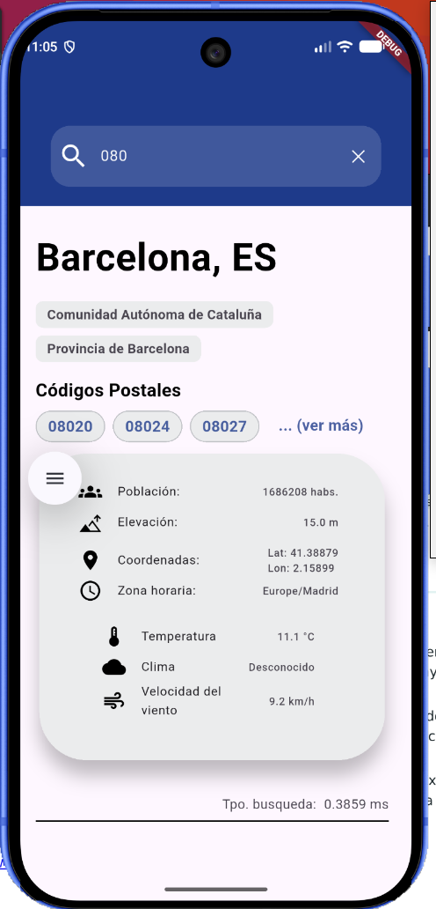
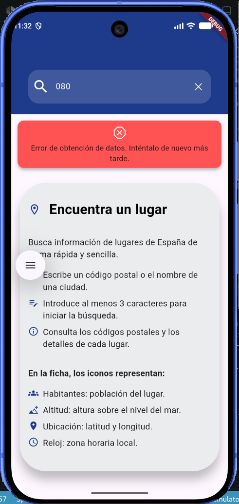
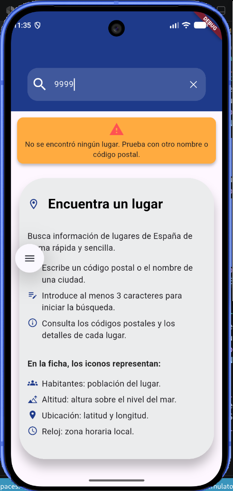
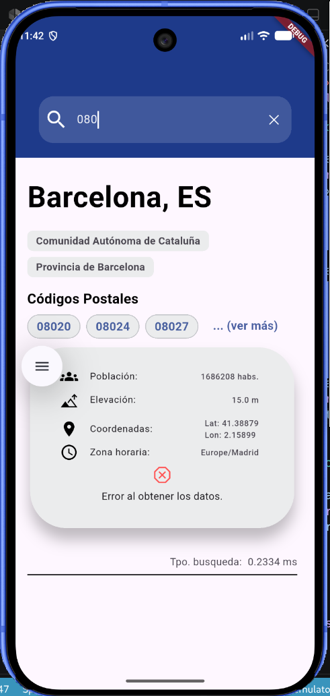

# Postcodes

Aplicación Flutter para buscar lugares de España por nombre o código postal.
Muestra los datos geográficos encontrados y, usando sus coordenadas, consulta
también el tiempo actual del lugar.

## Funcionalidades
- Si no se ha realizado busqueda en el punto inicial aparece las instrucciones.
  {: width=100px}


- Búsqueda de lugares con un mínimo de tres caracteres.

- Resultados con códigos postales, población, elevación, coordenadas y zona
  horaria.
- Consulta del tiempo actual: temperatura, condición meteorológica y velocidad
  del viento.
  

- Mensajes para estados de carga, ausencia de resultados y errores.

  Errores:

  Error de conexión a internet
  
  Error de servicio de busquedas
  
  Error de código postal o nombre no encontrado.
  
  Error Weather -> error clima
  

  Nota: al ser el clima un dato secundario la respuesta para cualquier error será la misma, a nivel de usuario es indiferente cualquier otro error. 

- Botón flotante para volver al inicio cuando la pantalla se ha desplazado.

La búsqueda utiliza la API de geocodificación de
[Open-Meteo](https://open-meteo.com/en/docs/geocoding-api). El tiempo se obtiene
de su [API de predicción meteorológica](https://open-meteo.com/en/docs).

## Ejecutar el proyecto

Se necesita Flutter instalado y configurado. Desde la raíz del proyecto:

```bash
flutter pub get
flutter run
```

Para comprobar el análisis estático:

```bash
flutter analyze
```

## Cómo fue tomando forma

El proyecto empezó con una base pequeña: una pantalla de búsqueda, los modelos
para interpretar la respuesta de geocodificación, un servicio HTTP, un
proveedor para gestionar la búsqueda y los primeros estilos y widgets. Esa
separación inicial fue útil para poder añadir funciones sin concentrar toda la
aplicación en una sola pantalla.

Después llegó la presentación de los resultados. La respuesta de la API puede
contener varios lugares y más de un código postal, así que hubo que resolver
tanto cómo mostrar las listas como qué hacer cuando la información opcional no
está disponible. La ficha de cada lugar fue creciendo hasta incluir datos
geográficos y datos como la altitud y la población.

Una evolución natural fue aprovechar la latitud y la longitud para consultar el
tiempo. Esto añadió otro recorrido completo —servicio, modelo, conversión de
códigos meteorológicos y presentación— y convirtió los resultados en algo más
útil que una simple lista de códigos postales. También se fueron separando
widgets y estilos para que cada parte tuviera una responsabilidad más clara.

## Retrospectiva

### Lo que salió bien

- Empezar por modelos y servicios dio una base clara para conectar la API con la
  interfaz.
- El diseño por widgets permitió añadir datos como el tiempo sin rehacer toda
  la pantalla de resultados.
- Centralizar estilos y textos facilita mantener una presentación coherente y
  hacer cambios de forma localizada.
- Reutilizar las coordenadas del resultado para obtener el tiempo fue una
  extensión sencilla y útil de la funcionalidad original.

### Lo que costó más de lo esperadosin

El desplazamiento al inicio fue un buen ejemplo de un problema que no se veía
solo mirando el botón. El botón utilizaba un `ScrollController` asociado a una
lista interna, pero el desplazamiento real lo gestionaba la lista de la
pantalla. La solución fue compartir el controlador de la lista exterior y
colocar un único botón flotante en el `Scaffold`. La lección: al trabajar con
listas anidadas, primero hay que identificar cuál de ellas tiene realmente el
desplazamiento.

También algunas responsabilidades podrían estar mejor separadas.
Por ejemplo, el proveedor de búsqueda conoce las funciones de retorno del
widget de búsqueda. Funciona para conectar los estados actuales, pero hace que
la lógica de datos dependa de la interfaz y quizas eso complica las cosas
para probar partes por separado.

### Lo que me sorprendió y he aprendido

Lo más sorprendente fue que detalles pequeños de Flutter, como qué lista posee
el controlador de desplazamiento, pueden afectar una interacción aparentemente
simple. También quedó claro que una API puede devolver muchos datos opcionales
y colecciones de tamaño variable: la interfaz y los modelos deben contemplar
valores ausentes, listas vacías y respuestas inesperadas.

Ejecutar `flutter analyze` tras los cambios ayudó a detectar problemas de código
antes de probar la aplicación, no solía usar esa herramienta.

### Qué cambiaría en una siguiente iteración

- Añadir pruebas unitarias para la interpretación de respuestas, pero en este caso
  no tuve tiempo de hacer todo.

El proyecto sigue siendo una aplicación pequeña, pero ya tiene un flujo completo desde la consulta de datos hasta su resentación. Su siguiente paso natural sería reforzar las pruebas y separar un poco más la lógica de negocio
de la interfaz.

#### NOTA
Me pareció más interesante limitar la visualización de los códigos postales que ocultar toda la información para luego mostrarla. 
